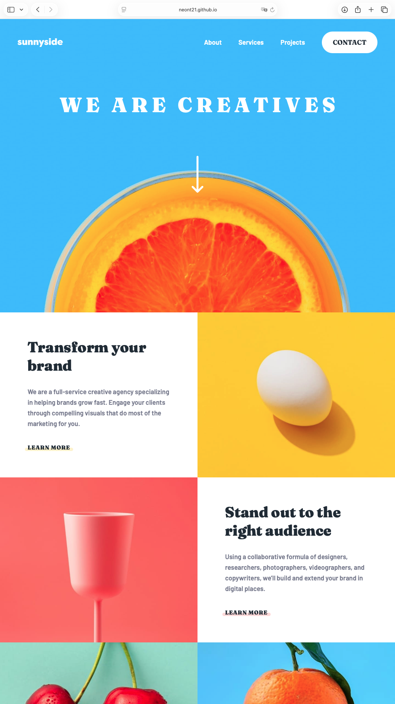
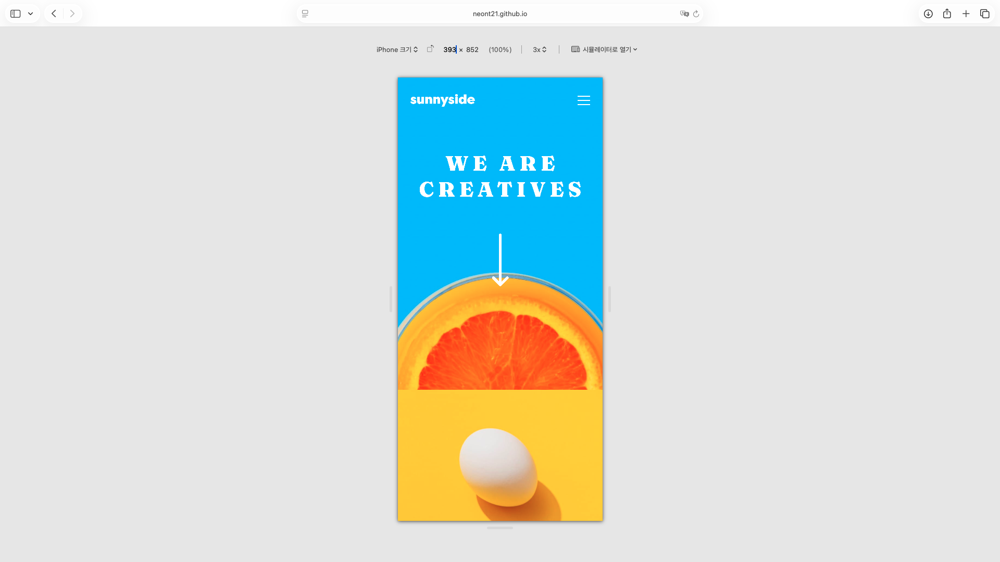

# Frontend Mentor - Sunnyside agency landing page

[Frontend Mentor의 Sunnyside agency landing page 챌린지](https://www.frontendmentor.io/challenges/agency-landing-page-7yVs3B6ef)를 구현한 레파지토리입니다.

## 목차

- [개요](#개요)
  - [과제 요구사항](#과제-요구사항)
  - [미리보기](#미리보기)
  - [링크](#링크)
- [개발 과정 및 아키텍처](#개발-과정-및-아키텍처)
  - [사용 기술](#사용-기술)
  - [핵심 기술적 의사결정 및 배운 점](#핵심-기술적-의사결정-및-배운-점)
  - [참고자료](#참고자료)
  - [AI 협업 회고](#ai-협업-회고)
- [작성자](#작성자)

## 개요

### 과제 요구사항

- 디바이스 화면 크기(320px 모바일 화면부터 1440px 이상의 대형 데스크톱 모니터까지)에 따른 최적의 반응형 레이아웃 제공
- 모든 인터랙티브 요소(링크, 버튼, 스크롤 화살표, 소셜 아이콘)의 호버 및 포커스 상태 구현
- 키보드 네비게이션 및 스크린 리더 친화적인 시맨틱 마크업 구축

### 미리보기

#### 데스크톱 화면 (Desktop View)


#### 모바일 화면 (Mobile View)


### 링크
- 프론트엔드 멘토 솔루션: [Frontend Mentor 솔루션](https://www.frontendmentor.io/solutions/sunnyside-landing-page-mobile-first-with-react-and-css-grid-UTr5Obs43G)
- 라이브 배포 사이트: [GitHub Pages 바로가기](https://neont21.github.io/sunnyside-agency-landing-page)

## 개발 과정 및 아키텍처

### 사용 기술
- **시맨틱 HTML5 랜드마크**: `<header>`, `<main>`, `<footer>`, `<section>`, `<nav>`, `<picture>`
- **CSS Custom Properties**: 디자인 시스템 토큰화 및 색상 관리
- **모바일 퍼스트 (Mobile-First)** 반응형 아키텍처
- **Unified CSS Grid**: 모바일과 데스크톱 전반에 걸친 단일 그리드 서식 맥락 유지
- **Pure CSS Modules**: 런타임 오버헤드 없는 스타일 캡슐화
- **유동적 반응형 수식**: 2점 선형 보간법($y = mx + b$) 기반의 CSS `clamp()` 계산
- **React 19 & TypeScript**: 엄격한 타입 안정성 및 컴포넌트 도메인 캡슐화
- **Vite & pnpm**: 격리된 의존성 구조 및 초고속 빌드 파이프라인

### 핵심 기술적 의사결정 및 배운 점

#### 1. 서식 맥락(Formatting Context) 일관성을 위한 Unified CSS Grid 도입

모바일에서 `display: flex;`를 쓰다가 데스크톱에서 `display: grid;`로 전환하는 전통적인 패턴 대신, 모바일 기본 스타일부터 **Grid Formatting Context (GFC)**를 선언하여 서식 맥락의 일관성을 유지했습니다:

```css
/* 기본 모바일: 1열 그리드 */
.section {
  width: 100%;
  display: grid;
  grid-template-columns: 1fr;
}

/* 데스크톱: 컨텍스트 전환 없이 열(Track) 정의만 확장 */
@media (min-width: 768px) {
  .section {
    grid-template-columns: repeat(2, 1fr);
  }

/* 명시적 2차원 좌표 지정을 통한 지그재그(Zig-zag) 배치 */
  .section > :nth-child(1) {
    grid-column: 2;
    grid-row: 1;
  }

.section > :nth-child(2) {
    grid-column: 1;
    grid-row: 1;
  }
}
```

* **도입 배경**: 브라우저 렌더링 엔진이 Flex 컨텍스트와 Grid 컨텍스트 사이를 오가며 겪는 서식 전환 오버헤드를 없애고, 자식 요소의 2차원 배치 속성(`grid-column`, `grid-row`)을 일관되게 제어하기 위함입니다.

#### 2. 스타일 가이드 불일치 및 접근성 해결을 위한 `color-mix()` 활용

제공된 스타일 가이드의 푸터 배경색 토큰(`--green-500: hsl(167, 34%, 41%)`)은 명도가 낮아 시안(L=70%)과 일치하지 않았고, 본문 텍스트(`--green-800`)와의 명도 대비비가 1.7:1에 불과해 WCAG AA 기준을 위반했습니다.

기존 토큰을 임의로 변조하거나 하드코딩하는 대신, CSS Color Module Level 4의 `color-mix()` 표준 함수를 활용했습니다:

```css
.footer {
  background-color: color-mix(in srgb, var(--green-500) 45%, white);
}
```

* **결과**: 디자인 토큰의 맥락을 계승하면서도 시안과의 시각적 일치율을 확보하고, **4.6:1의 안정적인 WCAG AA 명도 대비**를 달성했습니다.

#### 3. 2점 선형 보간법을 통한 엄밀한 `clamp()` 수식 도출

어림짐작 뷰포트 단위(`vw`)를 사용할 경우 320px 최저 너비 화면에서 푸터 메뉴가 줄바꿈되거나 넘치는 문제가 발생했습니다. 이를 해결하기 위해 두 기준점($320\text{px} \rightarrow 28\text{px}$, $375\text{px} \rightarrow 56\text{px}$)을 지나는 1차 함수($y = mx + b$)를 유도하여 오차 없는 유동적 갭을 적용했습니다:

$$\text{기울기 } m = \frac{56 - 28}{375 - 320} \approx 0.5091 \quad (50.91\text{vw})$$
$$y절편 b = 28 - (0.5091 \times 320) = -134.9\text{px} \approx -8.43\text{rem}$$

```css
.navList {
  gap: clamp(1.75rem, 50.91vw - 8.43rem, 3.5rem);
}
```

#### 4. `MediaQueryList` API를 통한 반응형 메뉴 상태 동기화

모바일 환경에서 햄버거 메뉴를 열어둔 상태로 기기를 가로로 회전하거나 데스크톱 분기점(768px 이상)으로 창을 넓혔을 때, React의 `isOpen` 상태와 `aria-expanded` 속성이 불일치하는 엣지 케이스를 발견했습니다.

무거운 `window.onresize` 대신 W3C 표준 `matchMedia` 이벤트 리스너를 바인딩하여 768px 분기점에 진입하는 순간 메뉴 상태를 안전하게 자동 초기화하도록 처리했습니다.

```tsx
useEffect(() => {
  const mediaQueryList: MediaQueryList = window.matchMedia('(min-width: 768px)');
  const handleMediaChange = (event: MediaQueryListEvent): void => {
    if (event.matches) {
      setIsOpen(false);
    }
  };

  mediaQueryList.addEventListener('change', handleMediaChange);
  return () => mediaQueryList.removeEventListener('change', handleMediaChange);
}, []);
```

### 참고자료

- [W3C CSS Grid Layout Module Level 2](https://www.w3.org/TR/css-grid-2/) - 그리드 트랙 정의 및 2차원 명시적 배치 표준 명세
- [MDN Web Docs: color-mix()](https://developer.mozilla.org/en-US/docs/Web/CSS/color_value/color-mix) - sRGB 색상 공간에서의 색상 혼합 표준 및 문법
- [W3C WCAG 2.1: Contrast (Minimum)](https://www.w3.org/WAI/WCAG21/Understanding/contrast-minimum.html) - 웹 콘텐츠 접근성 가이드라인 1.4.3 명도 대비(4.5:1) 기준
- [CSS-Tricks: Linearly Scale font-size with CSS clamp()](https://css-tricks.com/linearly-scale-font-size-with-css-clamp-based-on-the-viewport/) - 뷰포트 기반 선형 보간 수식($y = mx + b$) 유도 기법
- [MDN Web Docs: Window.matchMedia()](https://developer.mozilla.org/en-US/docs/Web/API/Window/matchMedia) - 뷰포트 미디어 쿼리 변화 감지 및 `MediaQueryList` 이벤트 리스너 표준

### AI 협업 회고

Google Antigravity와의 페어 프로그래밍을 통해 진행되었습니다. 단순히 생성된 코드를 복사하는 것이 아니라, "왜 이 기술과 속성을 사용해야 하는지"를 컴퓨터공학 이론과 웹 표준에 기반하여 집요하게 질문하고 검증했습니다.

특히 인페이지 앵커의 정보 구조적 한계 검토, Grid 서식 맥락 일관성, 접근성 명도 대비 계산 등 실무적인 엣지 케이스들을 주도적으로 짚어내며 완성도 높은 프로덕션을 완성할 수 있었습니다.

## 작성자
- Frontend Mentor - [@neont21](https://www.frontendmentor.io/profile/neont21)
- GitHub - [@neont21](https://github.com/neont21)
